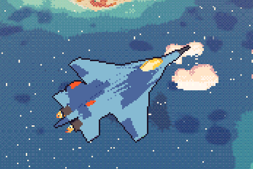
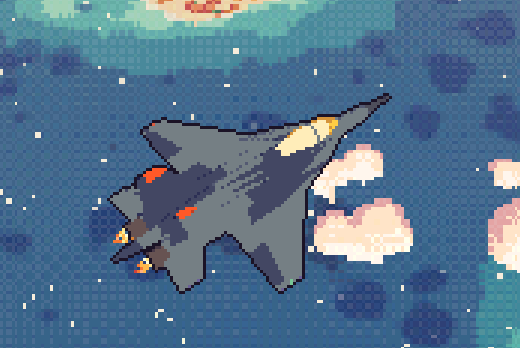
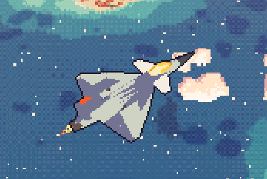
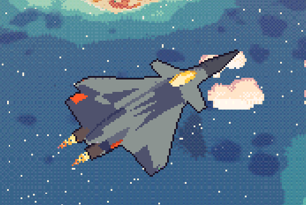
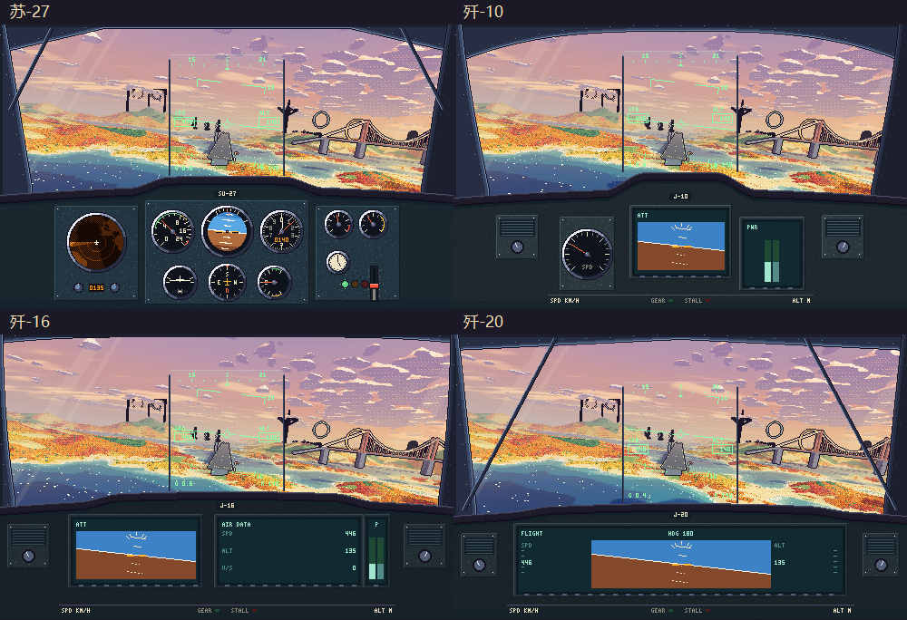
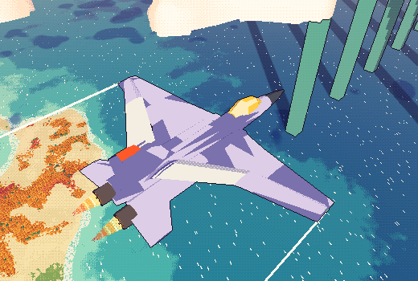
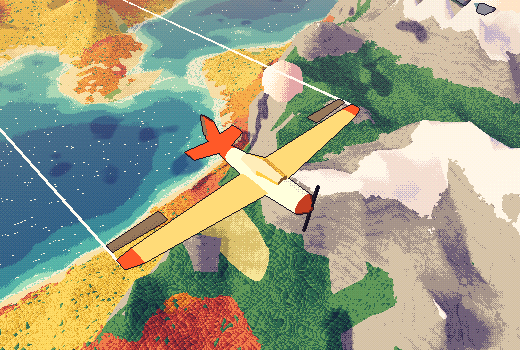
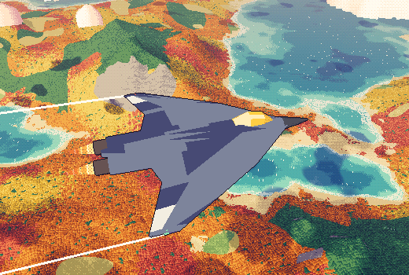
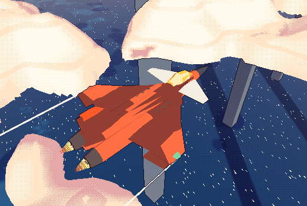
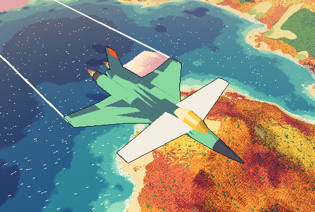

<h1 align="center">Dusk Patrol · 湖区飞行俱乐部</h1>

从湖岸机场起飞，贴着水面穿过悬索桥。独自练习特技，或和朋友编队、对战，每个房间最多 8 人。

  <a href="#两台电脑一起飞">开始联机</a> ·
  <a href="#机库">看飞机</a> ·
  <a href="#操作">查键位</a> ·
  <a href="#局域网-pvp">进入 PvP</a>

   
  <em>星斑 X-3 · 赤霞悬索桥下穿，出桥后右滚</em>

## 机库

| 苏-27 · 单座双发 | 歼-16 · 串列双座 |
| :---: | :---: |
|  |  |
| **歼-10 · 单发鸭式** | **歼-20 · 双发鸭式** |
|  |  |

四张图均为游戏截图。四架飞机在观光、PvE 和 PvP 里都能选，同房玩家可以各飞各的。造型取自公开照片，操控和部件耐久按游戏平衡设置。[苏-27P 航展照片](https://commons.wikimedia.org/wiki/File%3AUkrainian_Air_Force_Sukhoi_Su-27P_Flanker_%2843240429274%29.jpg) · [歼-10、歼-16、歼-20 同框照片](https://www.mod.gov.cn/gfbw/wzll/yw_214068/4830500.html)

出动后在追尾视角按一次 **空格**，就能看到所选飞机的驾驶舱。下图是在东湖长堤机场同一条进近线上拍的。苏-27 用圆表和琥珀色地形屏，歼-10 把姿态主屏放在中央，歼-16 把姿态和飞行数据分到两块屏，歼-20 用一整块宽屏。座舱布局为游戏原创。33 架飞机都有自己的仪表板和舱框组合。

[前 25 架飞机的结构复查](docs/AIRFRAME-REVIEW.md) · [同批机型三视角图板](docs/media/airframe-inspection.webp)

| 星斑 X-3 | 织云 R-5 | 信风 L-4 |
| :---: | :---: | :---: |
|  |  |  |
| 双喷口三维矢量，按住 `V` 可以同时俯仰、偏航和滚转。 | 联翼巡游机。按住 `V` 稳住俯仰，方便贴着起伏的地形观景。 | 电动滑翔机。在西岭浮灯附近按住 `V` 顺桨，借上升气流留空。 |

| 夜枭 N-6 | 火燕 U-1 | 蜻蜓 T-4 |
| :---: | :---: | :---: |
|  |  |  |
| 无尾六代概念机。按住 V，再踩 Q/E，观察两侧翼梢减速舵的开度。 | 静不稳定验证机。切到自由视角，轻点 S 并松杆，可以看见鸭翼随增稳修正。 | 前后两对翼面分担升力。按 V 增升、减速，适合沿船坞连续穿门。 |

| 云针 Q-5 | 白浪 D-8 |
| :---: | :---: |
|  |  |

两图均用游戏画面在 900 米、M 1.00 和相同机位下定格。云针的长机鼻参考 X-59，白浪的曲边三角翼参考协和。两架都是湖区俱乐部的虚构机型。[NASA X-59 外形介绍](https://www3.nasa.gov/specials/Quesst/how-x59-designed.html) · [史密森尼国家航空航天博物馆的协和介绍](https://airandspace.si.edu/stories/editorial/what-happened-concordes)

展开全部 33 架机型 · 巡航初速与飞行特性

| 飞机 | 空中出发速度 | 体验 |
| --- | ---: | --- |
| 苏-27 | 594 km/h | 单座双发、双尾与尾锥，V 辅助改平。 |
| 歼-10 | 587 km/h | 单喷口与机腹进气，W/S 驱动鸭翼，V 展开内襟翼。 |
| 歼-20 | 706 km/h | 棱面机身、活动鸭翼和外倾双垂尾，V 增加航向阻尼。 |
| 歼-16 | 594 km/h | 串列双座舱盖，V 稳向；游戏滚转比苏-27 缓和。 |
| 云针 Q-5 | 788 km/h | 长机鼻、窄后掠翼。按住 V 增加航向阻尼，固定机位听到的音爆较轻。 |
| 白浪 D-8 | 637 km/h | 曲边三角翼。V 放内襟翼，进近时仍可用外侧升降副翼调整姿态。 |
| 暮隼 G-6 | 706 km/h | 宽折线翼、低矮外倾双尾。倾侧时松开 A/D 并按住 V，可以看着两翼逐渐放平。 |
| 朱鹮 F-8 | 536 km/h | 红色前掠翼、活动鸭翼。按住 V，轻点 Q/E 就能带出同向滚转。 |
| 夜枭 N-6 | 734 km/h | 无尾折线翼、差动减速舵、升降副翼 |
| 火燕 U-1 | 590 km/h | 纵向静不稳定、自动增稳、差动鸭翼，V 可放宽辅助 |
| 蜻蜓 T-4 | 299 km/h | 串列翼巡游机，前翼随俯仰输入偏转，V 增升 |
| 银梭 R-2 | 821 km/h | 长机鼻、窄翼；V 增强航向阻尼，适合远程高速飞行 |
| 砂狐 D-4 | 670 km/h | 无尾三角翼；升降副翼同时响应俯仰与滚转，V 展开内侧襟翼 |
| 逆风燕 F-3 | 551 km/h | 前掠翼；V 配合方向舵带动联动滚转 |
| 极光 V-6 | 655 km/h | 重型三维矢量机，双喷口接受三轴输入，较大的惯量让姿态变化更缓 |
| 燕鸥 T-2 | 274 km/h | 青色长翼；V 展襟翼增升，同时增阻 |
| 长针 S-1 | 882 km/h | 细长机鼻、窄翼面。V 开加力，适合高速通场摄影 |
| 信风 L-4 | 155 km/h | 长展弦比电动滑翔机，V 顺桨降阻，可借山脊热气流留空 |
| 雨燕 A-7 | 353 km/h | 橙色短翼；V 配合 A/D 加强滚转，消耗速度 |
| 彗星 J-9 | 594 km/h | 灰色后掠翼、双垂尾，巡航快，转向需要预留空间 |
| 纸鸢 X | 353 km/h | 紫色鸭翼；V 配合 W/S 实现矢量偏转，过失速会损失速度。观光和 PvP 都可用 |
| 蝠鲼 M-6 | 310 km/h | 蓝色宽翼；V 把部分推力转成机体向上的升力，适合低速托举而非前冲 |
| 鹗翼 B-4 | 414 km/h | 金色翼梢小翼；V 释放空气制动，主动收速 |
| 流星 P-8 | 472 km/h | 红色窄后掠翼；V 蓄能冲刺，约 3 秒耗尽，松开恢复充能 |
| 苍鹭 H-3 | 324 km/h | 双层长翼；V 增加姿态阻尼，适合稳住队形与拍摄 |
| 海燕 G-5 | 374 km/h | 联翼；V 配合 Q/E 加强方向舵响应，同时增加阻力 |
| 白栎 O-6 | 364 km/h | 双梁长翼，V 辅助改平 |
| 鳐影 V-4 | 547 km/h | 外倾翼鳍，V 混合俯仰、偏航和差动滚转 |
| 流萤 C-7 | 587 km/h | 前置鸭翼，V 展开增升面 |
| 星斑 X-3 | 569 km/h | 轻型双喷口三维矢量机，滚转响应快 |
| 赤翎 D-2 | 760 km/h | 高速窄翼、鸭翼和腹鳍，V 加强俯仰机动 |
| 织云 R-5 | 400 km/h | 联翼观景机，V 增加俯仰阻尼，松杆后更快稳住机头 |
| RV-8A 参考机 | 220 km/h | 无武装的民用参考飞行模型和简化外形；用于可复核的三个性能点 |

机库标有「超声速」的 25 架飞机可以收轮平飞、按 R 加到满油门后持续越过 M 1。V 保留给各机特性。空中出发速度是巡航初速。

暮隼的宽翼平面参考了 GCAP 的公开概念模型，朱鹮的前掠翼和鸭翼参考了 X-29。两架飞机的尺寸、性能和按键特性均为本作设定。[GCAP 概念模型](https://www.baesystems.com/en-uk/article/global-combat-air-programme-partners-unveil-new-concept-model-of-next-generation-combat-aircraft) · [NASA X-29 照片](https://www.nasa.gov/image-article/x-29-over-californias-mojave-desert/)

## 两台电脑一起飞

**单人试飞**　解压后直接打开 `index.html`，选择「编队观光」，房间码留空即可出发。

**局域网开房**　房主需要 Node.js 20 或更新版本，玩家需要支持 WebGL 2 的浏览器和键盘。

1. 房主双击 Windows 下的 `start-lan.cmd`，或在项目目录运行 `node server.cjs`。保持终端打开。
2. 房主打开 `http://127.0.0.1:8787/`。朋友打开终端列出的 Wi-Fi 或以太网地址。
3. 各自选机、填写名字，选择相同玩法和房间码，例如 `LAKE`，然后进入空域。机库可以用 `Tab`、方向键和 `Enter` 操作。PvP 房间码留空会自动建房，一个人也能先飞。

房间规则与连接排查

首次进入时浏览器会生成地形，之后可从同地址的缓存读取。首位玩家决定房间玩法，观光成员加入时会出现在编队附近。PvP 从空中入场，对手由同房玩家操纵。两人起计分，对手进出时可以继续飞行。观光和竞技都可以在湖区机场起降。

左上角会显示房间码和人数。机上名牌、航图和榜单使用同一个飞行员名字，同房重名会自动添加数字后缀。按 `H` 离房回机库。

连接失败时，检查双方是否同一网段、访客 Wi-Fi 是否隔离设备，以及房主是否允许 Node.js 在**专用网络**入站使用 TCP 8787。不需要公网端口映射。请勿向公网开放：这是面向互信玩家的内存中继，房间码不是密码。用 Ctrl+C 停服；端口被占用时可在 PowerShell 设置 `$env:PORT=8788` 再启动。

## 操作

| 键位 | 控制 |
| --- | --- |
| W / S | 压低 / 抬高机头 |
| A / D | 左 / 右滚转，不会自动回正 |
| Q / E | 左 / 右方向舵 |
| R / F | 连续增加 / 减少油门，松键保持 |
| Shift + 上述按键 | 细控。俯仰、滚转、方向舵和油门变化速度取普通输入的 35%，适合编队微调或进近对线。松开 Shift 恢复全行程。 |
| L / Enter / Esc | 机库和飞行中都能打开配装。数字键装卸，Enter 保存到当前机型，Esc 取消。 |
| Tab / Shift+Tab | 战斗中向前或向后切换已装武器。左上角的 ▸ 指向当前选中的一件。 |

所有机型的座舱和外视角都能看雷达。雷达通常在右上角，竖屏座舱会把它移到风挡下方。座舱里，机头指向由中间的绿色准心标出。切换格斗弹、远程弹或激光炮，玻璃上的捕获圈也会跟着换。导弹蓄满时显示 LOCK。观光时，金色菱形标出所选航点，青色方框标出附近机场，按 K 换航点。挂载栏会列出这架飞机带了什么。观光开启武器保险，进入 PvE 或 PvP 后可以开火。[歼-20 横屏座舱实机图](docs/media/hud-j20.png) · [歼-10 竖屏座舱实机图](docs/media/hud-j10.png)

镜头、机型特性、起落架与其他键位

| 键位 | 控制 |
| --- | --- |
| U / Z | U 切换起落架，完整收放约 1.8 秒。地面收轮锁止，RV-8A 保留固定轮。按住 Z 使用轮刹。 |
| , / . | 按住逗号降低、句号增加俯仰配平。短按微调，松键保持。 |
| I | 把通场摄影机放到飞机前方偏侧，持续观测本机或选中的队友。C 返回追尾。 |
| 空格 / C | 空格循环外部、座舱和俯视等视角；C 直接进入自由镜头，再按返回原视角 |
| 方向键 / [、] | 自由环绕时改变水平角、仰角 / 拉远、拉近；不改变飞机姿态 |
| G / 0 | 自由镜头下，G 固定拍摄位置，从地平线稳定的机位观看飞机飞过；再按恢复环绕。0 重置到当前飞机侧面 |
| Y | 在队友和本机间轮换第三人称观测对象；自己的飞机继续飞行。方向键环绕，C 返回。 |
| M / H | 声音开关（记住静音偏好） / 返回机库 |
| P / Shift+P | P 查看帧时间与机体、地景的内部分辨率。Shift+P 循环自动、流畅、精细三档。 |
| 7 | 打开或收起八部位机体损伤图。受到损伤时也会短暂弹出。 |
| V | 按住使用本机特性。二维机用 W/S 控制喷口俯仰。三维机还可用 Q/E 侧摆、A/D 差动滚转，三组按键可同时使用。C 自由镜头可查看喷口和角度读数。彗星是被动高速型 |

## 湖区航线与活动

观光空域覆盖 81.92 × 81.92 km。按 N 打开北向航图，O 在附近与全域之间切换，K 切换航点。仪表显示距离、目标方位、当前航向与航点高度。观光可在机库选十八个出发点，已有领机时会在编队附近加入。

| 地点 | 玩法 |
| --- | --- |
| 赤霞悬索桥 | 从北向南穿过两座红塔之间的桥下主跨开始计时。再次正向穿桥可重新开始。 |
| 云梯双环 | 接续穿桥路线，爬升穿过琥珀环，再穿青色环完成计时。飞行面板记录本次出动的最佳成绩。 |
| 日晷中继站 | 紫色日晷环上方是首个竞技信标，适合盘旋争分。 |
| 白帆灯港 | 在观光房中，至少两架飞机同时留在灯港航点水平 320 米、高差 175 米的范围内 5 秒，全房记一次集结。离开到不足两架后可以再挑战。 |
| 东湖长堤机场 | 场高 30 m，跑道长 2,300 m，宽 80 m。适合第一次练习起落。 |
| 西湾灯船机场 | 场高 14 m，2,000 × 68 m。沿琥珀色边灯进场。 |
| 台地云港 | 场高 181 m，1,550 × 62 m。高架跑道更短，接地后要留够滑跑距离。 |
| 折光船坞 | 从北向南依次穿过琥珀、青、紫三门，第二门向西错开。船坞有独立计时和最佳成绩，也参与 PvP 信标轮换。 |
| 苍穹渡槽 | 可以从长槽下方穿越连续桥跨，也能从相邻支柱之间侧向出峡。 |
| 西岭浮灯 | 两只系留气球夹着有上升气流的山脊。信风 L-4 可顺桨，绕浮灯比较空速与升降率。 |
| 晨光岬灯列 | 跟随五座交错的岬角灯塔向南通场。 |
| 北境拱门 | 对准拱心穿过北方山口，两侧岩柱可作转弯参照。 |
| 南岬风廊 | 沿三对蓝白翼标连续穿门，练习高速换向。 |
| 西岭天文台 | 双穹顶是山脊通场的参照物，也是轮换信标之一。 |

PvP 信标每 45 秒在中继站、天文台、云梯和折光船坞之间轮换。出生保护结束后，独自在当前信标范围内连续飞行 4 秒得 1 信标分。出现第二架符合条件的飞机或离开时，当前占领进度清零。按 B 导航到当前信标并自动跟进轮换。航图榜单按信标分、击毁数排序。集结和竞技成绩随房间清空而结束。

## 外环探索

从机库选琥珀高架廊、月壳海湾、蓝针石林、浮灯天阶、折光船坞或苍穹渡槽，就能直接飞到航点前方。沿航图指示的高度穿过航点可收集外环通场记录。记录保存在当前浏览器，按飞行员名字区分。

白栎 O-6 是长翼双梁测绘机，按住 V 并松开滚转杆，机翼会逐渐改平。鳐影 V-4 可在按住 V 时组合三个轴。流萤 C-7 的前置鸭翼与襟翼随 V 展开，适合低速进近。三架都可以进入观光和 PvP 房。

低空机影取自正在飞行的模型。起落架、舵面和滚转姿态都会进入投影，跑道、桥面和水面均能接影。地标阴影按固定光照在加载时生成一次。

## 跑道与通场

   
  <em>燕鸥 T-2 · 东湖长堤机场进近、接地与刹车</em>

第一次可以选东湖长堤机场和“五边进近练习”。游戏将飞机放在已经配平的短五边，机轮放下。保持中线，接地后按 F 减油门、按住 Z 刹停。随后松开 Z，按 R 增加油门，用 Q/E 修正方向；接近 HUD 的抬轮参考速度时按 S 抬头，确认爬升后用 U 收轮。也可以选“跑道起飞”从静止开始。一次观光出动中在三座不同机场接地，可集齐三个转场记录。HUD 同时显示接地下沉率。主轮、前轮或机腹首先接地会产生不同结果。重着陆可能损伤轮架，倾斜擦地可能伤及一侧机翼，缓和的机腹迫降可继续滑行。附近的平缓草地也可迫降。撞水、深撞实体或机身结构耗尽仍会损失一架飞机。

导弹碰到哪个部件，双方 HUD 都会显示名称。满血时左翼中弹，机体余 58 HP，左翼耐久余 22%，右翼保持完好。受击后能继续操纵的飞机可以尝试返场维修。

按 **7** 查看左右翼、尾翼、发动机、机身、左右主轮和前轮。地标擦碰、飞机互擦和 PvP 命中使用同一套状态。翼损会减少升力并造成偏滚，尾翼损伤降低操纵响应，动力和制动也会随对应部件受损而衰减。机场跑道上停稳并把油门降到怠速，持续 6 秒可完成地勤维修；观光和 PvP 均适用。

第三人称能看到两侧副翼反向偏转、尾部升降舵、方向舵、机轮和支柱。纸鸢的喷口与尾焰一起偏转，螺旋桨转速、机背升力风扇、襟翼和减速板随各机的控制状态变化。用 C 环绕观察，I 设前方通场机位。长针从空中出发时可加大油门并按住 V 越过 M 1。低空接近 M 1，凝结云沿这架飞机自己的翼根、翼折点和翼尖铺开。云针的云带窄而靠后，白浪的云带随着三角翼向两侧展开。进入空域默认有声。追尾视角穿过 M 1 时会响一声短促的双爆音。切进座舱，接近 M 1 时能听到低沉的气流抖动，速度继续升高便淡出。按 I 把镜头架在航线前方，等激波扫过这个位置再听音爆。机身长度影响两声之间的间隔，机型和观察距离影响响度。[试听游戏里的机外音爆](docs/media/sonic-pass.wav) · [NASA 对音爆的说明](https://www.nasa.gov/wp-content/uploads/2021/09/120274main_fs-016-dfrc.pdf)

## AI PvE · 湖区巡逻队

房主启动 `start-lan.cmd`，打开终端里的本机地址，在机库选择 **PvE · 湖区巡逻队**。房间码留空即可独自出发。朋友打开房主的局域网地址，选同一玩法并输入同一房间码，就能中途加入。每房最多 8 名玩家，AI 有独立席位。

第一波是燕鸥和海燕，第二波 3 架，第三波 4 架，会遇到歼-10 和歼-16。每架 AI 出生时，房主从 **27 套配装**里随机抽一套，同一波内不重复。九种装备都有机会出现，每架带两到三件，总计最多 7 点。按 **T** 换目标就能看对方带了什么，**▸** 标出它当前选中的装备。按 **B** 看目标方位，中途加入也能看到同一套挂载。

和朋友分头飞时，巡逻机会分开追人。近距离交会后，它会先飞开再折返；遇到浮标或染光印的光圈会尝试绕开，贴近地面时优先拉起。对方拿机炮时能看到它分段连射，拿激光炮时则必须持续对准你才能放出来。受伤的巡逻机如果带了折光镜阵，会有短暂的反应时间才开盾。队友免伤，每波清空后有 5 秒空档，第三波清空后休息 15 秒再开新一轮。

## 局域网 PvP

*信标争夺中的双人视角。晚风从追尾镜头看到北辰的名牌，同时可以在右上雷达跟踪对方的方位。*

32 架飞机均可参加 PvP，可与其他玩家选择相同或不同的机型。机型在入房时确定，重生保留选择；换机请按 H 回机库后重新加入。每人有 100 HP 和 7 点配装预算，同一武器的冷却一致。房主以 120 Hz 模拟飞行，包括矢量、风扇、空气制动及冲刺充能；客户端仅发操纵和开火意图，本地预测和服务端回正。右上雷达按北向显示房间内的飞机。金色方框是当前目标，橙色是其他对手，青绿色是队友。每次击毁得 1 分，被击毁约 2 秒后重生，有短暂双向出生保护。赛场半径为 32 km，高度上限 7,200 m。浅擦地标按接触部位判损，严重结构撞击或越界会重生。房间清空后战绩不保留。

展开对战键位、武器点数与冷却时间

| 对战按键 | 游戏规则 |
| --- | --- |
| L / 1–6、8、9、− / Enter | 打开配装，按对应键装上或卸下，Enter 提交，Esc 取消。首次出动默认带机炮和格斗弹，共 6 点。机库可以选起步组合，再按数字键逐件调整；每架飞机单独存档。机炮 2 点、燕尾格斗弹 4 点、流光远程弹 5 点、激光炮 5 点、共鸣脉冲 3 点、折光镜阵 2 点、染光印 3 点、回声浮标 3 点、跳光链 4 点。至少选一件，最多 7 点。等待对手时立即换装，交战中更换组合需 5 秒，期间可飞行，重生保留配置。 |
| 5 / J | 折光镜阵展开 1.6 秒，抵消一次命中，6.5 秒后可再次展开。 |
| 9 / J | 回声浮标留在释放位置，1 秒后对 155 游戏米内的每个对手造成 28 点伤害。紫色环是范围提示，冷却 5 秒。 |
| − / J | 跳光链连接 440 游戏米内的选定对手，造成 18 点伤害。如果其周围 210 游戏米内还有对手，再连向最近的一架，造成 12 点伤害。冷却 6 秒。 |
| 6 / J | 染光印给 700 m 内对手此刻所在的位置盖章。1.2 秒后仍在印记中心 115 m 内扣 30 HP，离开则避开。冷却 4.2 秒。 |
| 4 + 按住 J | 已装备共鸣脉冲时，向周围玩家释放范围能量，每次造成 23 点伤害，3.6 秒冷却。 |
| T | 自动选中最靠近圈心的敌机，也可按 T 指定。最多三架敌机可以同时在圈内蓄锁，按 T 换主目标时保留其他飞机的进度。看到目标中央的金圈和 LOCK 后点按 J。每次按键只发一枚，发射后立刻按 T 也能接着选下一架。 |
| 1 + 按住 J | 沿机头连续发射每秒 30 发的像素曳光弹，每发都有弹迹，空房也能练习。房主按弹迹与机体相交判命中。从冷枪开始可连续打 96 发，约 3.2 秒。过热后锁止，约 2.5 秒降至 20% 解锁。 |
| 2 / J | 燕尾格斗弹在 2,000 游戏米内使用宽锁定圈，连续捕获 1.05 秒后显示 LOCK，按 J 发射，冷却 4.8 秒。 |
| 8 / J | 流光远程弹的锁定距离为 550–4,400 游戏米，准星圈较窄，连续捕获 1.85 秒，冷却 8 秒。飞行途中带青色光迹。两种弹均需直接接触机体，按最先碰到的模型部件结算，直接打中机身可击毁满血机。翼面、尾翼、发动机和起落架各有独立耐久。展开的折光镜阵可以抵挡一次命中。飞机出圈或超距会丢掉自己的进度。切换武器会清空这组标记。 |
| 3 + 按住 J | 保持同一目标在激光炮的瞄准圈内，按住 J 可看到照射进度。连续照射 2.2 秒击毁目标，出圈、换目标或松键会清零。 |
| X | 满载 12 枚。点按连放 3 枚，余量不足时放出剩余的。按住可连续放空，松开会放完当前一组。从投出第一枚起，每满 60 秒补回 1 枚，到 12 枚为止。继续投放不会重置计时。HUD 显示余量和下一枚的倒计时，玩家和 AI 共用库存规则。 |

北向雷达用短线标出航向，量程外的飞机在边缘显示空心点。看机外名牌可以读到目标的高低方向、逐机捕获百分比和 LOCK；切到机炮，近处主目标旁边会出现金色预瞄菱形。锁定预警和来袭提示分开，被跟踪时是间隔较长的单响，来袭时是急促的双响。炮温到顶有下降音，冷却解锁有上升音。座舱还能听到失速、快速接近地面的提示；机场有收放轮、接地、滚行和检修完成声。所有声音由浏览器本地合成。热诱弹的亮点、烟迹和空间层次参考了航展公开影像；发射节奏和补充规则属于游戏设定。[航展照片](https://www.dvidshub.net/image/8397186/gulf-coast-salute-air-show-2024)。

房主负责移动追踪弹的实体。最后一段动画会跟着目标的位置更新。短暂的滚转修正不会立刻断开追踪，持续的大幅机动或热诱弹仍可甩脱。弹体与弹翼接触飞机模型才造成伤害。擦过机翼或从机腹下飞过可脱靶，地标能挡弹，机炮曳光弹碰到弹体可在空中将其拦截。瞄准空处一样可以开火，弹迹会被地景和跑道拦下。武器和诱饵使用虚构规则。

**星标追逐**可以在机库单独选房。持星者带有星形标记，每持有 8 秒得 1 分；击毁持星者夺星并得 2 分。B 导航到持星者。两种 PvP 都记录助攻：其他玩家在击毁前 5 秒内对同一目标造成过伤害，即可获得一次助攻。

参考 [EA 的《星球大战：战机中队》PC 手册](https://www.ea.com/able/resources/star-wars-squadrons/pc/text-manual) 的 A/D 滚转，以及[《战地 6》官方载具说明](https://help.ea.com/en/articles/battlefield/battlefield-6/vehicles-guide/)将油门与姿态轴分开的做法。本版没有照抄任一默认布局，而是把俯仰也放在 WASD 区，不用鼠标控制飞行。

## 模拟精度

每 1/120 秒积分一次三维位置、速度、四元数姿态和三轴角速度。升阻取决于空气密度、空速及迎角，包含诱导阻力、侧滑侧力、超过临界迎角后的升力衰减、舵面响应和发动机迟滞。倒飞时升力也随机体转向；没有自动保高或一键筋斗。

民用参考机的数据来源、对比条件和没有实测依据的部分见 [验证说明](FLIGHT-VALIDATION.md)。解压后在本目录运行 `node flight-check.cjs` 可复核数值。虚构纸鸢的矢量过失速不是现实战机眼镜蛇的经验证复现；跑道接地采用简化轮胎与姿态模型，跨声速阻力采用经验曲线，结构破坏仍以游戏碰撞判定。参考机不带矢量控制，也不会进入 PvP。

## 验证与性能

运行 `node lake-check.cjs` 验证桥下通行、结构碰撞、信标换点与争夺、双人持续集结、预算和换装。运行 `node fleet-check.cjs` 验证机型特性、八人混合房、重生与镜头。房主和玩家请使用同一版本，竞技协议版本为 14。运行 `node airfield-check.cjs` 可复核 33 架飞机 × 3 座机场的连续落地、刹停、再起飞、收轮，以及音锥和新增配装。

运行 `node range-check.cjs` 复核持续平飞超声速、外围航点及赛场边界。十八处地点共用静态顶点缓冲，只绘制进入镜头范围的批次。地标坐标随游戏加载，联机同步玩家与活动进度。航图底图在地形生成后绘制一次，打开时每 150 毫秒更新位置和榜单。按 P 可以在自己的设备上查看平均帧耗时、FPS 和内部渲染分辨率。

运行 `node patrol-check.cjs` 复测两种弹的顺飞、横穿和斜穿，三目标蓄锁、换目标发射、预警、脱靶和拦截。运行 `node pve-check.cjs` 可复测巡逻路线、受损开盾、队友免伤与八人合作。字体随包提供，许可见 PixelifySans-OFL.txt 和 IBMPlexMono-OFL.txt。

运行 `node perf-check.cjs` 可复测速率和联机数据量。渲染、八机齐射和缓存启动的实测条件与结果见 [飞行与性能验证](FLIGHT-VALIDATION.md)。
