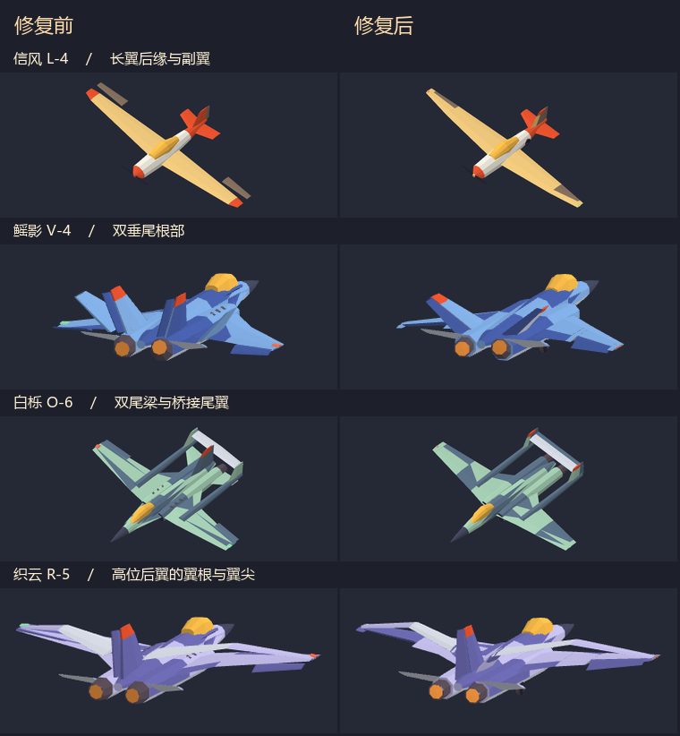

# 全机库模型结构复查

在上一版 `8a9fba9` 中，信风的两片副翼在操纵杆居中时就与主翼分离。把 25 架飞机分别摆到 8 组姿态后，16 架至少出现过一次实体翼段、舵面或轮架与机体分离，合计 102 组。织云的后翼能从翼尖连回机体，但内端缺少翼座。这类接错位置的问题需要另外检查。

## 逐架检查记录

每架都检查了主翼翼根、外段副翼、尾部操纵面、轮腿和动力装置。下表列出各机型额外关注的连接。完整图板每行一架，三列依次是前上方中立姿态、后上方组合操纵和放轮后的机腹视角。[放大全部 75 个视图](media/airframe-inspection.webp)

| 机型 | 结构与活动面 |
| --- | --- |
| 燕鸥 T-2 | 内襟翼和外副翼从各自的翼段后缘切出，各有铰链。 |
| 雨燕 A-7 | 短翼副翼随本翼后缘和上反角，平尾根部伸入发动机短舱。 |
| 彗星 J-9 | 双垂尾从左右短舱背部起根，两片方向舵分别绕倾斜轴转动。 |
| 纸鸢 X | 鸭翼轴座与前机身搭接，平尾与二维喷口各有支点。 |
| 蝠鲼 M-6 | 升力风扇移到主翼前缘前方，短梁承托环形外壳。叶片接到轮毂，转盘下方留出通流空间。 |
| 鹗翼 B-4 | 翼梢小翼根部嵌入固定翼尖。减速板与副翼单独偏转。 |
| 流星 P-8 | 旧版静止时副翼就有间隙。新版副翼前缘与主翼共享折线，鸭翼轴座接入前机身。 |
| 苍鹭 H-3 | 主翼的折线和上反角由连续翼段形成，取消了悬在翼面上方的重复翼片。 |
| 海燕 G-5 | 联翼后翼内端接背部翼座，外端接主翼固定尖段。 |
| RV-8A 参考机 | 外张主轮腿从机腹起根，前轮和两侧主轮保持放下。螺旋桨从桨毂伸出。 |
| 长针 S-1 | 窄后掠翼的副翼沿实际后缘偏转。长机鼻与机身由连续截面组成。 |
| 信风 L-4 | 长翼副翼直接切入后缘，两片长条不再悬在翼后。起落架沿机腹支点收放。 |
| 砂狐 D-4 | 无水平尾翼。内襟翼和外升降副翼分别占用相邻的后缘翼段。 |
| 逆风燕 F-3 | 前掠翼上的副翼沿前掠方向布置，前机身轴座承托差动鸭翼。 |
| 极光 V-6 | 鸭翼、双垂尾、全动平尾和三维喷口分别接到前机身或相应尾部短舱。 |
| 银梭 R-2 | 修复窄翼静止时的副翼间隙。腹鳍从短舱下表面起根。 |
| 白栎 O-6 | 两根尾梁从主翼延至双垂尾，桥接平尾连接两侧固定垂尾。移除了原先叠加的中央垂尾和另一对平尾。 |
| 鳐影 V-4 | 原来悬在外侧的一对斜鳍并入主尾翼布局。双垂尾从对应短舱起根，方向舵跟随各自垂尾的后缘。 |
| 流萤 C-7 | 增升鸭翼接在前机身两侧。鸭翼与内襟翼使用各自的转轴。 |
| 星斑 X-3 | 折线翼由一条连续翼型生成，后部采用一对有根部支撑的外倾垂尾。 |
| 赤翎 D-2 | 前置鸭翼接回机身轴座，腹鳍从短舱起根，双喷口在短舱内搭接。 |
| 织云 R-5 | 高位后翼从背部翼座向外伸展，并在固定翼尖闭合。两端分别检查接触。 |
| 夜枭 N-6 | 无垂尾。升降副翼与翼尖分裂舵各占一段后缘。分裂舵上下两瓣从同一轴张开。 |
| 火燕 U-1 | 鸭翼穿过机身轴座，差动和增稳操纵使用同一套活动翼面。主翼与升降副翼共用后缘截面。 |
| 蜻蜓 T-4 | 串列前翼从机身轴座向两侧伸展，后翼另有翼根，前翼偏转不会带动后翼。 |

## 怎么复核

1. 在项目根目录运行 `node model-check.cjs`。脚本从生成的实体截面出发，用面法线及棱边叉积检查相邻实体是否接触，再从机身遍历可达部件。每架覆盖操纵杆居中、正反组合输入、收轮、半收轮、放轮及特性展开。间隙容差为 0.001 个模型单位。尾焰和凝结云属于显示特效。
2. 共检查 200 组姿态。除整体连通外，还单独检查两侧主翼与机身、鸭翼与轴座、联翼的内外端、双尾梁与平尾、升力风扇的叶片与轮毂，并检查活动面转轴上的点在偏转时保持原位。
3. 在 Edge 的 WebGL2 顶点着色器中另外摆出每架 5 组姿态，读回实体顶点，同房主端的网格姿态逐顶点比较。SwiftShader 实测最大单坐标差约 0.0004 个模型单位。实机页面也复核了自由视角、旁观队友和机库选机。
4. 运行 `node airfield-check.cjs` 可复核全部 75 次起降循环。进游戏后，在机库选择信风或织云，切到自由环绕，按住 A/D 并从后上方观察，最容易看到副翼与固定翼段之间的铰链。

这次复查验证了游戏网格的安装位置和动画几何。除 RV-8A 已单列的飞行性能参考点外，这些机型使用游戏设定。可见翼座与尾梁的尺寸没有经过真实材料强度、载荷或适航试验校核。
